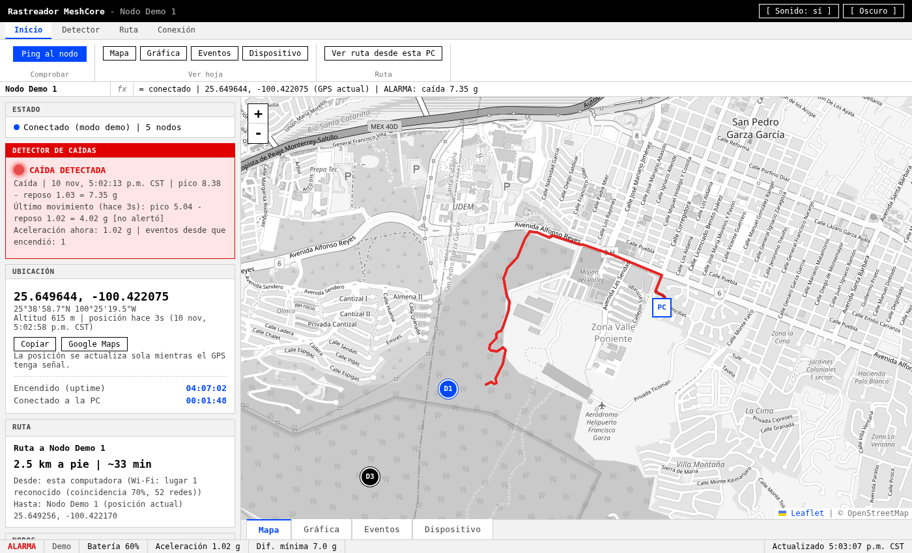
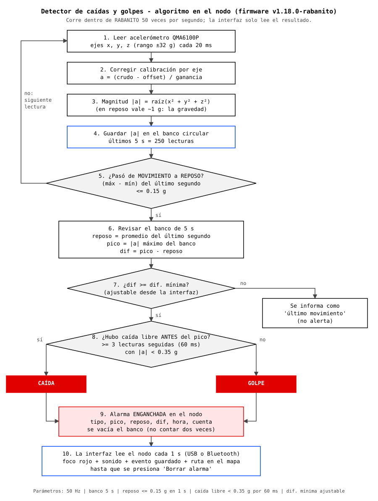

# sri
Interfaz, Sistema de Respuesta Inmediata, Huasteca, usando tecnologìa meshcore y LoRa

Interfaz para rastrear y vigilar un nodo LoRa con firmware
**MeshCore** modificado: última ubicación GPS en el mapa, **detector de caídas y golpes** con el acelerómetro,
gráfica en vivo, registro de eventos, ruta automática desde esta computadora hasta el nodo y terreno 3D
con elevación.



## Estado actual (10 nov 2026)

| Componente | Estado |
|---|---|
| Interfaz web | Funcionando |
| Conexión con el nodo por **Bluetooth** o **USB** | Funcionando (Linux) |
| Firmware MeshCore v1.18.0 modificado (`v1.18.0-rabanito`) | Instalado en RABANITO |
| Detector de caídas/golpes (banco de 5 s, pico - reposo) | Funcionando; 35 eventos de prueba |
| Acelerómetro a ±32 g con calibración de 6 caras | Calibrado (reposo = 1.00 g) |
| Ruta desde la PC hasta el nodo | Funcionando (ubicación de la PC por lugares Wi-Fi) |
| Terreno 3D (curvas de nivel sobre el mapa), alturas y perfil de la ruta | Funcionando (AWS Terrain Tiles, sin clave) |
| Información ambiental: cuerpos de agua que cruza la ruta | Funcionando (OpenStreetMap) |
| Clima en el nodo y avisos (tormenta, lluvia, viento, calor, luz del día) | Funcionando (Open-Meteo) |
| Programa instalable (.deb): programa de escritorio o modo estación | Listo (x86_64); ver [plan](docs/plan-estacion.md) |
| Funcionamiento sin internet (paquete de región de La Huasteca) | Listo: mapa, relieve, agua y clima guardado |
| Radio | 915 MHz (banda permitida en México) |
| Alertas por la malla LoRa a otros nodos | Pendiente |

Historia completa por etapas y resultados de las pruebas: **[docs/avance.md](docs/avance.md)**.

## Cómo funciona el detector



Explicación, fórmulas, parámetros y limitaciones: **[docs/detector-de-caidas.md](docs/detector-de-caidas.md)**.

## Inicio rápido

```bash
uv venv .venv && uv pip install -p .venv -r requirements.txt
.venv/bin/python server.py --ble AA:BB:CC:DD:EE:FF   # o --port /dev/ttyACM0 (USB), o --demo
```

Abrir http://localhost:5000. Sin opciones, `server.py` usa la última conexión elegida en la interfaz.

## Documentación

| Documento | Contenido |
|---|---|
| [docs/avance.md](docs/avance.md) | Avance del proyecto por etapas, resultados y pendientes |
| [docs/detector-de-caidas.md](docs/detector-de-caidas.md) | Algoritmo de detección con diagramas |
| [docs/firmware.md](docs/firmware.md) | Cambios a MeshCore, compilar y flashear |
| [docs/conexion.md](docs/conexion.md) | USB y Bluetooth en Linux, problemas resueltos |
| [docs/interfaz.md](docs/interfaz.md) | Uso de la interfaz, ruta, calibración, datos y API |
| [docs/plan-estacion.md](docs/plan-estacion.md) | Plan para la estación al aire libre (nativo y sin internet) |
| [docs/instalacion.md](docs/instalacion.md) | Construir, instalar y operar el programa en la estación |

## Estructura del repositorio

```
server.py                 Servidor web (Flask) y API
meshcore_source.py        Conexión con el nodo MeshCore (USB / Bluetooth)
sri_config.py             Rutas de datos, configuración y guardado seguro
static/index.html         Interfaz web (una sola página; Leaflet en static/vendor/)
sri_region.py             Paquetes de región y detección de internet
empaquetar/               Construcción del programa (PyInstaller) y del paquete .deb, servicio systemd
region/                   Construcción del paquete de región (mapa, relieve, agua) para usar sin internet
firmware/
  rabanito-acelerometro.patch               Cambios sobre MeshCore v1.18.0
  RABANITO-meshcore-v1.18.0-rabanito-ble.uf2  Firmware Bluetooth listo para flashear
  RABANITO-meshcore-v1.18.0-rabanito.uf2      Firmware USB listo para flashear
docs/                     Documentación; docs/img/ con diagramas (generar_diagramas.py) y capturas
herramientas/             Scripts auxiliares de etapas anteriores
requirements.txt          Dependencias (requirements.lock: versiones exactas probadas)
```

`data/` (ubicaciones, eventos, calibración, lugares Wi-Fi) se crea al usar la interfaz y **no se sube**.

## Licencia

GPL-3.0 (ver [LICENSE](LICENSE)). El firmware parte de [MeshCore](https://github.com/meshcore-dev/MeshCore) (MIT)
y la interfaz usa [Leaflet](https://leafletjs.com) (BSD-2),
mapas y cuerpos de agua de © OpenStreetMap (ODbL) y [Protomaps](https://protomaps.com), fuentes Noto Sans
(OFL), elevación de AWS Terrain Tiles y clima de
[Open-Meteo](https://open-meteo.com) (CC BY 4.0).
