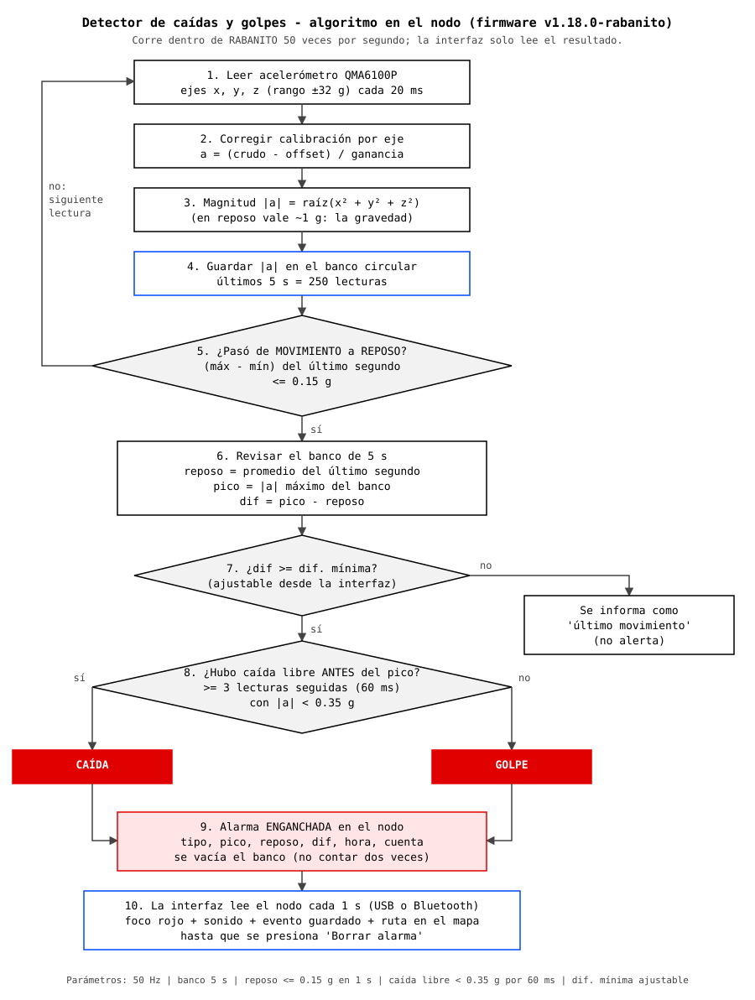
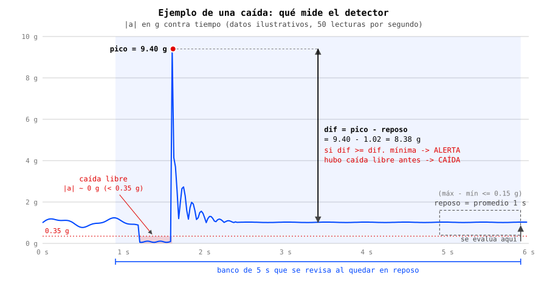

# Detector de caídas y golpes

El detector corre **dentro del nodo** (firmware `v1.18.0-rabanito`, archivo
`variants/t1000-e/target.cpp` del parche). La interfaz solo lee el resultado y lo muestra.
Se hace en el nodo porque un golpe dura milisegundos y la interfaz lo consulta una vez por segundo.



## 1. Medición

- Sensor: **QMA6100P** (I2C 0x12), rango **±32 g**, 14 bits por eje -> **256 LSB/g** (resolución ~3.9 mg).
- Se lee cada **20 ms** (50 veces por segundo).
- Cada eje se corrige con la calibración de 6 caras y se calcula la magnitud:

```
a_eje = (crudo_eje - offset_eje) / ganancia_eje
|a|   = raíz(a_x² + a_y² + a_z²)
```

En reposo |a| ~ 1 g (la gravedad), sin importar la orientación del nodo.

## 2. Banco de 5 segundos y detección de reposo

- Cada |a| se guarda en un **banco circular de 250 lecturas** (los últimos 5 s).
- El nodo está **en reposo** si en el último segundo (50 lecturas) `máx - mín <= 0.15 g`.
- Solo cuando pasa de **movimiento a reposo** se evalúa el banco. Mientras alguien carga o sacude el nodo no se
  evalúa nada, así que eso no dispara la alarma.

## 3. Pico, reposo y diferencia

Al quedar en reposo:

```
reposo = promedio de |a| en el último segundo
pico   = |a| máximo del banco (5 s)
dif    = pico - reposo
```

- Si `dif >= dif. mínima` -> **alerta** (la dif. mínima se ajusta desde la interfaz; 40 g por defecto en el
  firmware, 7 g durante las pruebas).
- Si no, se reporta como "último movimiento" (sin alerta), útil para calibrar la dif. mínima.
- Después de evaluar se **vacía el banco** para no contar el mismo pico dos veces.



## 4. ¿Caída o golpe?

Un objeto en **caída libre** no "siente" la gravedad: |a| baja casi a 0 g. Por eso:

- Se revisan las lecturas **anteriores al pico** en el banco.
- Si hay **3 lecturas seguidas (60 ms) con |a| < 0.35 g** -> **CAÍDA**.
- Si no -> **GOLPE**.

El tipo es solo una etiqueta: la alarma depende únicamente de la diferencia.

## 5. Alarma y comunicación con la interfaz

El resultado queda **enganchado** en el nodo hasta que la interfaz lo borra, y se lee por "custom vars" de MeshCore:

| Variable | Contenido |
|---|---|
| `impacto` | `1` alarma activa / `0` sin alarma (escribir `0` la borra) |
| `impacto_info` | `tipo\|pico*100\|epoch\|cuenta\|dif*100\|reposo*100` |
| `umbral_g` | dif. mínima en g (1 a 55) |
| `acel` | `actual*100\|mín*100\|máx*100` desde la lectura anterior (para la gráfica) |
| `ultimo` | último movimiento evaluado: `pico*100\|reposo*100\|dif*100\|epoch` |
| `acc_cal` | (solo escritura) calibración `ox\|oy\|oz\|gx\|gy\|gz` en milésimas |

La interfaz las lee cada segundo y, con una alarma nueva: pone el foco en rojo, suena, guarda el evento en
`data/impactos.jsonl` y traza la ruta hasta la última ubicación del nodo.

## 6. Parámetros

| Parámetro | Valor | Dónde |
|---|---|---|
| Frecuencia de muestreo | 50 Hz (20 ms) | `ACC_PERIOD_MS` |
| Banco | 5 s (250 lecturas) | `HIST_N` |
| Ventana de reposo | 1 s, `máx - mín <= 0.15 g` | `QUIETO_N`, `QUIETO_RANGO_G` |
| Caída libre | `< 0.35 g` durante 3 lecturas (60 ms) | `FREEFALL_G`, `FREEFALL_N` |
| Dif. mínima | 40 g por defecto, ajustable 1-55 g | `umbral_g` |
| Rango del sensor | ±32 g por eje (magnitud hasta ~55 g) | `QMA_RANGO` |

## 7. Limitaciones conocidas

- **Muestreo de 50 Hz**: un golpe de pocos milisegundos puede tener un pico real mayor al registrado.
- **La alerta llega al quedar en reposo** (~1 s después de que el nodo se detiene), no en el instante del impacto.
- Si el impacto ocurre **más de 5 s antes** de que el nodo quede quieto, el pico ya salió del banco.
- **60 ms de caída libre equivalen a ~1.8 cm** de altura (h = ½·g·t²): casi cualquier caída del nodo cuenta como
  "caída". En cambio, en la **caída de una persona** el cuerpo frena y gira y |a| suele quedarse en 0.3-0.6 g,
  así que muchas caídas reales podrían etiquetarse como "golpe".
- La dif. mínima y la calibración viven en la RAM del nodo: se pierden al reiniciarlo (la interfaz reenvía la
  calibración al conectar).

Los diagramas se generan con `python3 docs/img/generar_diagramas.py`.
