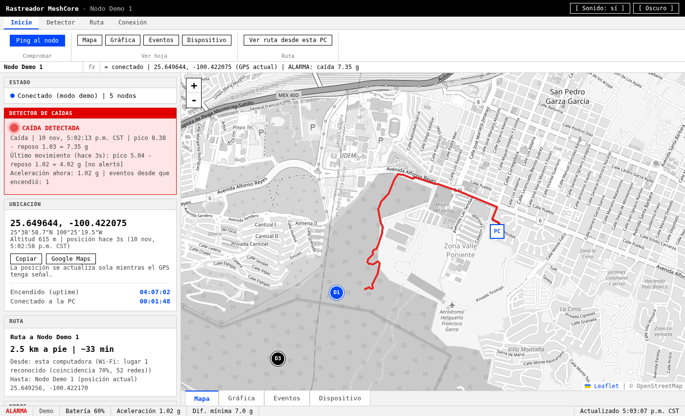
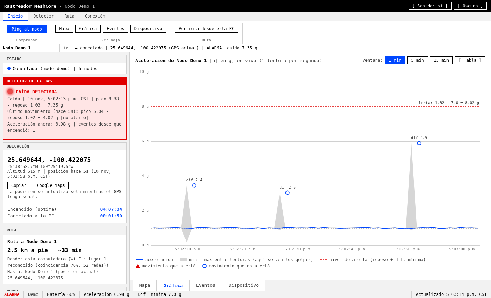
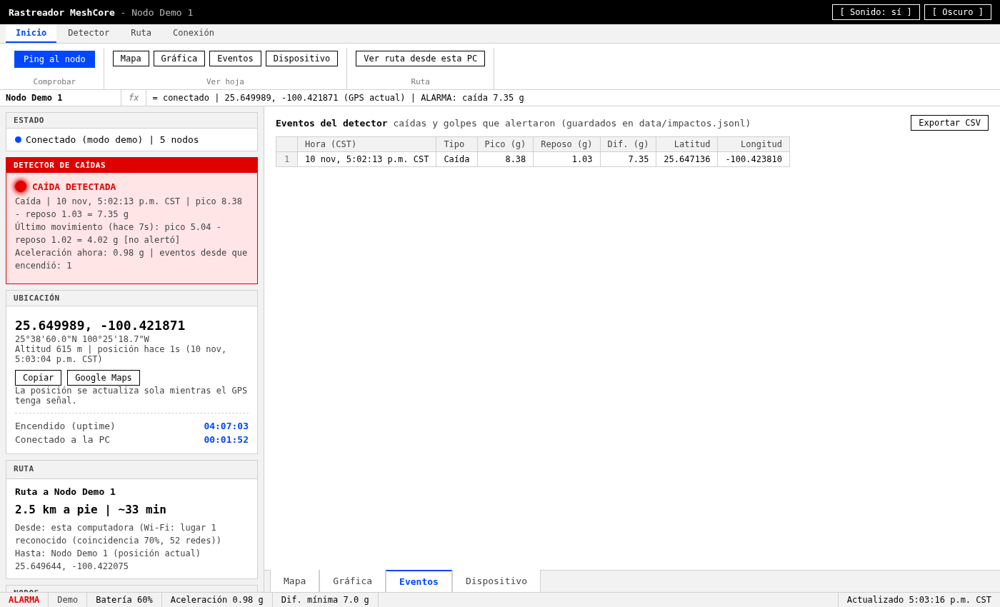
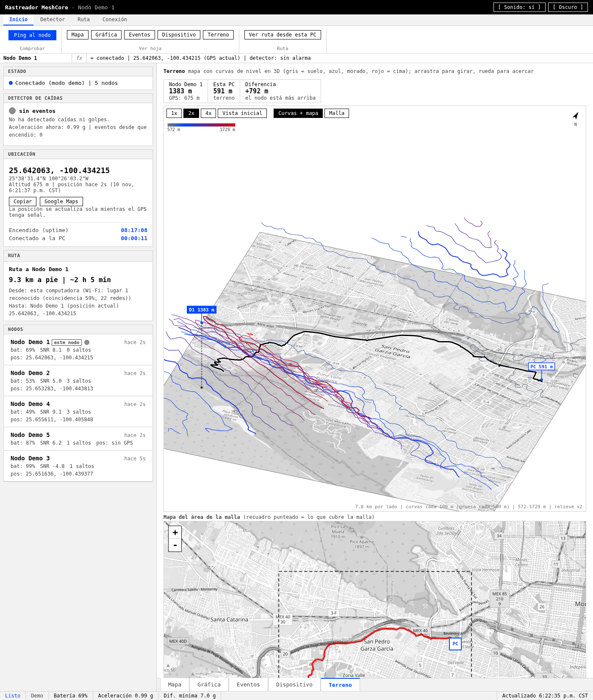

# Interfaz

Interfaz web organizada **al estilo Excel**. Las capturas son del modo demo (nodos simulados).

## Partes de la pantalla

| Parte | Qué contiene |
|---|---|
| **Barra de título** | Nombre del nodo, sonido sí/no, tema claro/oscuro |
| **Cinta de opciones** | Todos los botones, en pestañas: **Inicio** (ping, hojas, ruta), **Detector** (borrar alarma, dif. mínima, calibrar, eventos, CSV), **Ruta** (modo, Google Maps, quitar, ubicación de la PC), **Conexión** (USB / Bluetooth) |
| **Cuadro de nombre + barra de fórmulas** | Nodo y resumen de su estado en una línea |
| **Panel lateral** | Solo información: Estado, Detector de caídas, Ubicación, Ruta, Nodos |
| **Hojas (abajo)** | Mapa, Gráfica, Eventos, Dispositivo, Terreno. Se pueden abrir directo con `?hoja=terreno`, etc. |
| **Barra de estado** | Listo / ALARMA, conexión, batería, aceleración, dif. mínima, hora de actualización |

Colores: blanco y negro, **azul** para lo resaltado (este nodo, en vivo, OK) y **rojo** para alertas. Todas las
horas en CST (Monterrey).

## Hojas

**Gráfica** - aceleración en vivo (1 lectura por segundo). La banda gris es el mínimo-máximo que midió el nodo
entre lecturas (ahí se ven los golpes); la línea roja punteada es el nivel de alerta (reposo + dif. mínima);
los marcadores son los movimientos evaluados (triángulo rojo = alertó, círculo azul = no).

**Eventos** - tabla de caídas y golpes que alertaron, con **Exportar CSV** (UTF-8, se abre bien en Excel).

**Dispositivo** - identidad, firmware, GPS, sensores y radio del nodo.

**Terreno** - vista 3D del área que cubre el nodo, la PC y la ruta. Se gira e inclina arrastrando, se acerca
con la rueda; botones 1x/2x/4x para exagerar el relieve y "Vista inicial". Dos modos:
- **Curvas + mapa** (por defecto): el mapa de calles en blanco y negro es el piso, con la ruta en rojo (igual que en la hoja Mapa), y encima
  las **curvas de nivel** a su altura real, en **gris (modo claro) o blanco (modo oscuro)**; una de cada cinco
  es más gruesa. Los **cuerpos de agua** van en **azul**. (Con `CURVAS_MONO = false` en `index.html` vuelve la
  rampa gris -> rojo por altura.) El nodo y la PC tienen un poste punteado desde el mapa hasta su altura.
- **Malla**: malla de alambre (90x90 puntos) en el mismo color y el agua encima.

**Información ambiental (cuerpos de agua)** - ríos, arroyos, canales, drenes, lagos, presas y estanques de
OpenStreetMap (consulta a Overpass; solo se envía el recuadro del área). Para no saturar la vista solo se dibujan
los **importantes** (ríos, canales con nombre y lagos/presas/estanques de 2 ha o más), los que **cruza la ruta** y los
que tienen nombre a menos de 200 m de ella; las líneas se simplifican al detalle visible. Se ven en azul en el 3D,
en el mapa de abajo y en el perfil, con marcadores **"~ AGUA | nombre"**.
Debajo del perfil se listan:
- los cuerpos de agua que **cruza** la ruta (intersección exacta de la ruta con el río o el contorno del lago) y
  a qué distancia desde la PC; en el perfil aparecen como franjas azules;
- los que pasan **cerca** (a menos de 200 m), con la distancia y el km de la ruta.
En áreas grandes (~25 km) la primera consulta tarda ~30 s; luego se guarda en `data/agua/` y se reusa mientras el
nodo no se mueva ~2 km. Si Overpass está saturado se prueban dos servidores espejo y la página reintenta sola.

Debajo hay además un **mapa normal del mismo recuadro** (línea punteada) con la ruta, el nodo y la PC. Muestra:
- **Alturas** sobre el nivel del mar del nodo y de esta PC, y la diferencia entre ambos (la del nodo también
  con la altitud que reporta su GPS, que suele ser mayor).
- **Perfil de elevación de la ruta**: subidas y bajadas desde la PC hasta el nodo, con subida/bajada acumulada,
  altura mínima/máxima y pendiente máxima. Al pasar el mouse por el perfil se marca el punto en la malla y en el
  mapa.

Elevación: mosaicos abiertos **AWS Terrain Tiles** (formato terrarium, sin cuenta ni clave). El servidor calcula
la altura exacta de cada punto (`POST /api/elevacion`, zoom 14, ~9 m por píxel) y la malla
(`GET /api/terreno/malla`, con el zoom más detallado que quepa en 16 mosaicos); comprobado con el centro de
Monterrey (534 m) y el Cerro de la Silla (~1,750 m).

## Ubicación y ruta

- **Visto por última vez**: si el GPS pierde señal, el mapa muestra la última posición guardada (marcador rojo
  punteado) con la hora.
- **GPS apagado en el nodo**: si el GPS de RABANITO está apagado (por ejemplo con 4 pulsaciones seguidas del botón
  o desde la app MeshCore), aparece un aviso rojo en Ubicación con el botón **Encender GPS**, y "GPS APAGADO" en la
  barra de fórmulas y en la barra de estado. El nodo guarda el ajuste al encenderlo.
- **Ruta automática** desde esta computadora hasta la última ubicación del nodo, con distancia y tiempo (a pie,
  en coche o línea recta). Con una alarma, la ruta se destaca y la interfaz cambia a la hoja Mapa.
- Rutas por calles con OSRM (routing.openstreetmap.de): se envían las coordenadas de la PC y del nodo. Sin
  respuesta, se dibuja línea recta.
- **Ubicación de la PC** (no tiene GPS): la primera vez en un lugar se fija con un clic en el mapa y se guarda la
  huella de las redes Wi-Fi; después el lugar se reconoce solo. Todo queda en la computadora
  (`data/lugares_wifi.json`).

## Clima en el nodo

Tarjeta **Clima en el nodo** en el panel lateral (datos de [Open-Meteo](https://open-meteo.com), gratis y sin
clave), para la última posición del nodo:
- temperatura, sensación térmica, humedad, mínima/máxima del día, viento y ráfagas con su dirección, nubes,
  visibilidad, salida y puesta del sol e índice UV;
- las próximas 12 horas: temperatura y probabilidad de lluvia;
- **avisos para salir a campo**: tormenta eléctrica, lluvia (probable, ahora o fuerte), ráfagas de viento,
  calor o frío por sensación térmica, niebla, poca luz del día (90 min antes de la puesta) o de noche, UV alto;
- si se espera lluvia y la ruta **cruza cuerpos de agua**, aviso en rojo de posible crecida (también en la
  información ambiental de la hoja Terreno);
- la temperatura del sensor del nodo para comparar (está dentro de la carcasa y suele marcar más).

Se envían a Open-Meteo las coordenadas redondeadas a ~1 km; la consulta se reusa 10 min. La temperatura y el
estado del cielo también aparecen en la barra de estado.

## Calibración del acelerómetro

Cinta **Detector -> Calibrar acelerómetro**: poner el nodo quieto sobre cada una de sus 6 caras, "Medir cara" y
luego "Aplicar". Se guarda en `data/calibracion.json` y se reenvía al nodo en cada conexión.

## Datos locales (`data/`, no se sube al repositorio)

| Archivo | Contenido |
|---|---|
| `connection.json` | Última conexión (USB/Bluetooth) |
| `last_seen.json` | Última posición GPS de cada nodo |
| `impactos.jsonl` | Eventos del detector con su posición |
| `calibracion.json` | Calibración del acelerómetro |
| `lugares_wifi.json` | Lugares de la PC y sus huellas Wi-Fi |
| `agua/` | Cuerpos de agua ya consultados a OpenStreetMap (caché por recuadro) |

## API del servidor

| Ruta | Uso |
|---|---|
| `GET /api/nodes` | Estado y nodos (posición, batería, detector) |
| `GET /api/info` | Información del dispositivo |
| `POST /api/ping` | Ping al nodo |
| `GET /api/acel?segundos=60` | Historial de aceleración (gráfica) |
| `GET /mapa/{z}/{x}/{y}.png` | Mapa base: paquete de región, o OpenStreetMap con internet |
| `GET /api/region` | ¿Hay internet? y paquetes de región instalados |
| `GET /api/clima?lat=..&lon=..` | Clima actual, próximas 12 h, datos del día y avisos (Open-Meteo) |
| `POST /api/gps` `{"encendido": true}` | Enciende o apaga el GPS del nodo (el nodo guarda el ajuste) |
| `GET /api/impacto/historial` | Eventos guardados |
| `POST /api/impacto/reset`, `/api/impacto/umbral` | Borrar alarma / cambiar dif. mínima |
| `GET/POST /api/calibracion/...` | Calibración de 6 caras |
| `GET /api/ruta?desde=lat,lon&hasta=lat,lon&modo=pie` | Ruta |
| `POST /api/elevacion` `{"puntos": [[lat, lon], ...]}` | Altura del terreno de cada punto (máx. 500) |
| `GET /api/terreno/malla?caja=lat1,lon1,lat2,lon2&n=90` | Rejilla n x n de alturas para la malla de alambre |
| `GET /api/terreno/agua?caja=lat1,lon1,lat2,lon2` | Cuerpos de agua de OpenStreetMap en el recuadro (áreas y líneas) |
| `GET /api/mi_ubicacion`, `POST /api/mi_ubicacion/fijar` | Ubicación de la PC por Wi-Fi |
| `GET /api/connection`, `POST /api/connect`, `GET /api/ble/scan`, `GET /api/ports` | Conexión |
